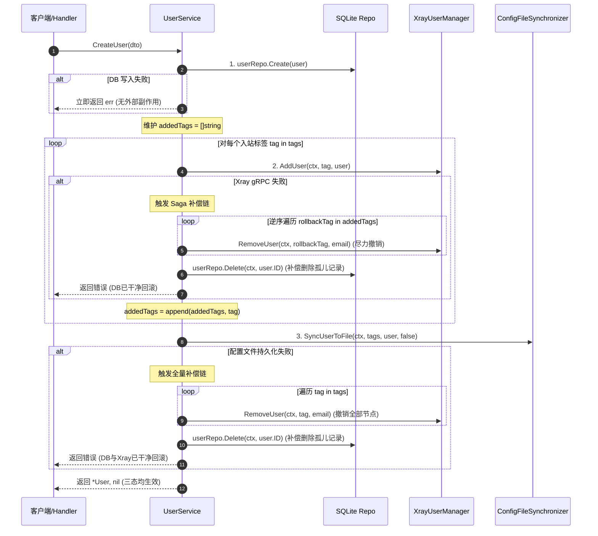

# 测试缺陷与质量门禁全面治理 技术设计方案

## 1. 架构拓扑与三态一致性模型

系统在运行时维护三份异构状态存储：
- **SQLite 数据库 (GORM)**：业务真相源（Source of Truth），持久化存储用户账号、凭证、节点授权与到期策略；
- **Xray-core 内存 (gRPC API)**：运行时的动态路由分发与活跃连接管理；
- **物理磁盘 `config.json`**：守护进程（Supervisor）冷启动恢复、进程重启载荷与保底镜像。

由于三个异构存储之间无法使用跨系统的两阶段提交（2PC），为解决“API 成功但底层未注入，或底层失败导致 DB 残留孤儿数据”的问题，本设计在应用服务层（`UserService`）实现 **Saga 反向补偿机制（Compensating Transactions）**，确保事务执行失败时触发精确的逆向回滚。



---

## 2. 核心模块重构设计

### 2.1 依赖解耦与接口抽象 (`ConfigFileSynchronizer`)
为了使 `UserService` 的物理落盘逻辑能够被单测 Mock 故障注入，在 `internal/service` 中定义细粒度接口：

```go
type ConfigFileSynchronizer interface {
    SyncUserToFile(ctx context.Context, authorizedTags []string, user *domain.User, isDelete bool) error
    SaveConfigQuietly(ctx context.Context, remark string) error
}
```

- `ConfigService` 天然实现该接口。
- `UserService` 结构体持有 `configSvc ConfigFileSynchronizer`，既不破坏原有构造注入，又支持测试期间直接注入 `MockConfigSynchronizer` 进行故障模拟。

---

### 2.2 用户生命周期 Saga 补偿链设计

#### A. `CreateUser`
- **正向路径**：DB Create ➔ Xray 逐个 AddUser ➔ Config 落盘。
- **逆向补偿**：
  - 若 `AddUser` 失败：逆序 `RemoveUser` 已添加成功的 tags，并调用 `userRepo.Delete(ctx, user.ID)`，返回 `%w` 包装错误；
  - 若 `SyncUserToFile` 失败：`RemoveUser` 所有 tags，并调用 `userRepo.Delete(ctx, user.ID)`，返回 `%w` 包装错误。
- **业务收益**：彻底消除 DB 孤儿账号，用户下次以相同 Email 重试将不会收到“邮箱已存在”的虚假冲突。

#### B. `UpdateUser`
- **正向路径**：
  1. 获取旧用户实体并生成深拷贝快照 `oldSnapshot := *oldUser`；
  2. 计算 tag 差集（`tagsToRemove`, `tagsToAdd`）；
  3. 更新 DB；
  4. 刷新 Xray 内存；
  5. 持久化落盘。
- **逆向补偿**：
  - 若 Xray 调整失败或写盘失败：
    - 补偿恢复 Xray 内存至 `oldSnapshot` 状态；
    - 补偿回滚 DB 实体至 `oldSnapshot`；
    - 返回错误。

#### C. `ResetSubToken`
- **正向路径**：
  1. 记录旧凭证快照：`oldUUID = user.UUID`, `oldToken = user.SubToken`；
  2. 生成新 UUID 与 Token，更新 DB；
  3. Xray 内存卸载旧凭证、注入新凭证；
  4. 持久化落盘。
- **逆向补偿**：
  - 若 Xray 注册或落盘失败：
    - 将 DB 中用户的 UUID 与 SubToken 恢复为 `oldUUID` 与 `oldToken`；
    - 恢复 Xray 节点为旧凭证；
    - 返回错误，杜绝凭证处于中间态。

#### D. `DeleteUser` 顺序重构与防撕裂
- 调整执行顺序为：
  1. Xray 内存热剔除（具备幂等容忍性）；
  2. 物理 `config.json` 同步剔除并静默落盘（若失败直接报错阻断，此时 DB 记录未被破坏）；
  3. 最后彻底从 SQLite 删除记录；
  4. 清理运行时内存测速缓存。

#### E. 批量操作错误聚合
- `BatchRenew`、`BatchResetTraffic`、`BatchSetStatus`：
  - 循环内记录每条失败项的错误；
  - 使用 `errors.Join(errList...)` 聚合返回，避免静默 `continue`。

---

### 2.3 启动阶段容灾与日志告警设计

在 `main.go` 启动时：
```go
if err := configSvc.SyncFromFile(bgCtx); err != nil {
    slog.Error("failed to sync config from file on startup, proceeding with database config", slog.Any("error", err))
}
if err := configSvc.RecompileAndApply(bgCtx, "面板启动自动同步与编译配置"); err != nil {
    slog.Error("CRITICAL: failed to compile or reload xray config on startup", slog.Any("error", err))
}
```
- 不再用 `_ =` 忽略错误；
- 若出现严重故障，在日志中明确打出结构化 `CRITICAL`/`ERROR` 告警，便于运维人员排查。

---

### 2.4 CI 质量门禁加固设计

1. **前端类型检查门禁**：
   在 `.github/workflows/ci.yml` 构建任务中，在 `npm run build` 前增加：
   ```yaml
   - name: Run Web Typecheck
     run: |
       cd web
       npm ci
       npm run typecheck
   ```
2. **下载官方 Xray-core 二进制激活真实测试**：
   在 CI 的 `test` job 中增加 step：
   ```yaml
   - name: Install Xray-core for Integration Tests
     run: |
       XRAY_VER="v24.9.30"
       mkdir -p bin
       curl -sSL "https://github.com/XTLS/Xray-core/releases/download/${XRAY_VER}/Xray-linux-64.zip" -o xray.zip
       unzip -q xray.zip -d bin/
       chmod +x bin/xray
       echo "$(pwd)/bin" >> $GITHUB_PATH
   ```
   使 `xray_integration_test.go` 能成功找到 `xray` 二进制，不再执行 `t.Skip()`。
3. **版本号统一事实源**：
   修正构建命令，将 `-X 'main.Version=v1.3.0-ci'` 改为与当前主版本一致的 `-X 'main.Version=v2.6.2-ci'`。
