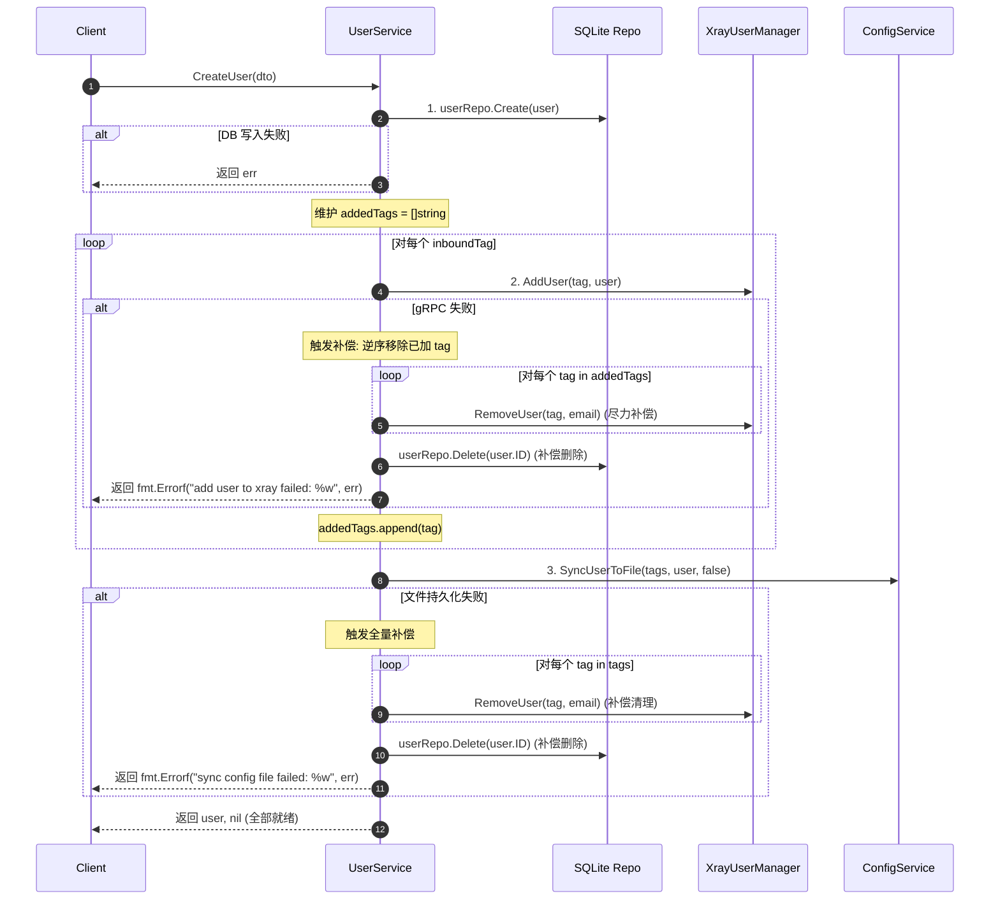

# 用户CRUD三态一致性与Saga失败补偿技术设计

## 1. 架构拓扑与一致性现状

当前系统维护三份状态：
- **SQLite DB (GORM)**：持久化业务真相源；
- **Xray-core (gRPC)**：进程间运行态内存；
- **config.json (文件 I/O)**：冷启动与重载载荷。

由于异构系统无法使用单一两阶段提交（2PC），本设计采用 **应用层 Saga 反向补偿（Compensating Transactions）** 实现“一滚全滚”。

## 2. 补偿时序设计

### 2.1 CreateUser 时序与补偿链

### 2.2 UpdateUser 时序与补偿链
在更新前生成前置状态快照 `oldUserSnapshot := *oldUser`：
1. 校验与计算新旧 tag 差集（`tagsToAdd`, `tagsToRemove`）；
2. 写入 DB：`userRepo.Update(newUser)`；
   - 失败：直接返回，DB 未变，外部状态未变；
3. 调整 Xray 运行态：
   - 移除弃用 tags：`RemoveUser`；
   - 添加/刷新新 tags：`AddUser`；
   - 若 Xray 调整报错：
     - **触发补偿**：
       - 逆向恢复 Xray 节点至 `oldUserSnapshot` 状态；
       - `userRepo.Update(&oldUserSnapshot)` 还原 DB；
       - 返回错误。
4. 调用 `configSvc.SyncUserToFile`：
   - 若写盘失败：
     - **触发补偿**：
       - 逆向恢复 Xray 至 `oldUserSnapshot`；
       - 还原 DB 至 `oldUserSnapshot`；
       - 返回错误。
5. 成功返回。

### 2.3 ResetSubToken 时序与补偿链
1. 记录原 `oldUUID` 和 `oldSubToken`；
2. 更新 DB 为新 UUID 和 SubToken；
3. 更新 Xray 运行态（移除旧凭证，挂载新凭证）；
   - 若失败：恢复原 UUID 和 SubToken 回写 DB，还原 Xray 运行态挂载，返回错误；
4. 更新 `config.json`；
   - 若失败：全面恢复原凭证并报错。

### 2.4 DeleteUser 保证
1. 幂等性：移除 Xray 节点内存时，若错误为“用户不存在”或“入站未找到”，视为已达成目标态，不阻塞主流程；若为网络超时或致命错误，记录错误；
2. 同步移除 `config.json` 物理文件，如失败返回明确错误；
3. 从 DB 彻底删除记录；
4. 清理内存运行时速率追踪器。

## 3. 错误契约设计
- 所有的错误信息使用 `%w` 包装，提供清晰的失败阶段上下文，例如：
  `fmt.Errorf("add user to xray tag %q failed, rolled back db record: %w", tag, err)`
- 交付层（HTTP Handler）能据此返回 500 或 400，并携带明确错误描述，避免管理人员误以为操作成功。

## 4. 可测试性与 Mock 设计
在 `internal/service/user_service_test.go` 中：
- 构建 `mockXrayManager`，具备故障注入开关：
  - `AddUserErr error`
  - `RemoveUserErr error`
  - `RecordedCalls []string`
- 构建针对 `ConfigService` 或使用真实轻量 compiler + temp file 注入失败（如无写入权限的文件路径），验证两级补偿链的健壮性。
